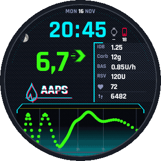
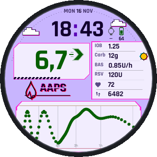
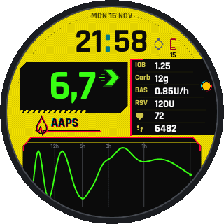
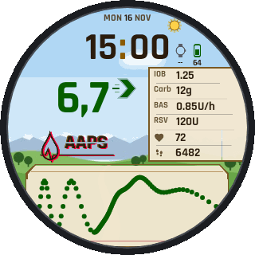
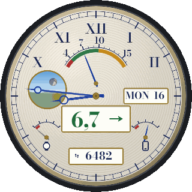
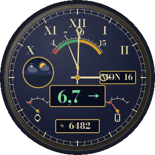
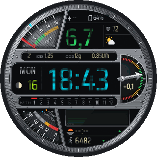

<h1 align="center">AndroidAPS · personal edition</h1>

  <b>Watch faces that wake up.</b> Rain, glitch bands and a beating heart when you raise your wrist. 
  A live preview of the watch face in AAPS on the phone. The Dexcom ONE+ / G7 read without xDrip+. 
  New versions of the watch app go from the phone to the watch with one button, no adb.

<table align="center">
<tr>
<td align="center" width="33%"> <b>Cyberpunk Tech</b> falling rain, a beating heart</td>
<td align="center" width="33%"> <b>Cyberpunk Weather</b> glitch bands, the weather of your place</td>
<td align="center" width="33%"> <b>Cyberpunk Yellow</b> glitch bands, a low battery blinks</td>
</tr>
<tr>
<td align="center" width="33%"> <b>Wilds Weather</b> a beating heart, sun and weather</td>
<td align="center" width="33%"> <b>Grand Complication Day</b> a dress watch, the real sun and moon</td>
<td align="center" width="33%"> <b>Grand Complication Night</b> midnight blue and gold, a low battery blinks</td>
</tr>
<tr>
<td></td>
<td align="center" width="33%"> <b>D2</b> steel and glass, a big trend arrow</td>
<td></td>
</tr>
<tr>
<td align="center" colspan="3">Each picture is drawn by the watch's own code, wake-up animation and all, by <code>ReadmeAnimationsTest</code>. The same code draws the live preview on the phone.</td>
</tr>
</table>

A personal fork of [nightscout/AndroidAPS](https://github.com/nightscout/AndroidAPS), made for the
OnePlus Watch 2R and other round Wear OS watches.

## Features

| | Feature | What it does |
|---|---|---|
| 🎬 | **Wake-up animation** | Rain, glitch bands and a heart that beats at your heart rate, when you raise your wrist. |
| 📱 | **Live preview in AAPS** | The phone shows your watch face as it looks on the watch now, animation and all. |
| ⚙️ | **Watch face settings in AAPS** | Set up the watch face on the phone and see it at once. Changes on the watch come back. |
| 🌗 | **Day face and night face** | One face for the day, one for the night, with the weather, the sun and the moon. |
| 🎨 | **Seven designs** | Cyberpunk Tech, Weather and Yellow, Wilds Weather, the analog Grand Complication for day and night, and D2. |
| 📈 | **Log time graph** | The last hour in detail and the whole day behind it, with the time ago under the graph. On every face with a graph. |
| 🌙 | **The real sun and moon** | They rise and set over a horizon as in the sky, the moon in its real phase, worked out on the watch. |
| 🔋 | **Battery on the face** | Phone and watch battery side by side. A low one blinks. |
| ❤️ | **Heart rate and steps** | On the watch face, from what the watch measures anyway. |
| 🪫 | **Longer watch battery** | Fewer redraws and fewer messages from the phone. |
| ⚡ | **Fast wake** | The watch face is there the moment you raise your wrist. |
| 🩸 | **Dexcom ONE+ / G7 without xDrip+** | AAPS reads the sensor itself, even straight to the watch. |
| 🚗 | **Glucose in the car** | AAPS says your glucose value over the car speakers. |
| 🚦 | **Status lights count down** | The sensor and pod lights show the time that is really left. |
| 📄 | **Logs to Downloads** | Save the logs without email. |
| ⌚ | **Update the watch from the phone** | The phone app carries the watch app. One button sends it to the watch, which installs it after you confirm. After the first install, no more debugging on the watch. |

> [!WARNING]
> **Not an official AAPS release.** Not reviewed by the AAPS team. AAPS doses insulin: use this
> only if you understand the code and the risk. The Dexcom ONE+ / G7 driver comes from an open
> upstream pull request ([#5431](https://github.com/nightscout/AndroidAPS/pull/5431)) that is not yet
> reviewed, and it is the glucose source of the loop.

## Install

1. Build `local/personal`: first `:wear:assembleFullRelease` and sign it, then
   `:app:assembleFullRelease -PembedWearApk=<signed watch APK>` for the phone, which then carries the watch app.
2. Sign the phone app with the same key as the AAPS you have now, and install with `adb install -r`, so
   your data and settings stay. Install the watch app once with adb and allow it to install updates:
   `adb shell appops set info.nightscout.androidaps REQUEST_INSTALL_PACKAGES allow`. Later updates:
   AAPS → Wear → **Update watch app** → **Send to watch** (several minutes, keep the watch close), then
   confirm on the watch.
3. In AAPS, load a design from `wear/cwf-designs` as the day face, and another one as the night face
   if you like.

## Version

Based on AAPS 4.0.0 with the Dexcom ONE+ / G7 pull request #5431 (upstream `dev` at `951df2fa89`);
each new upstream release is merged in.
