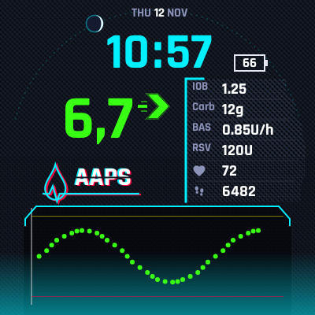
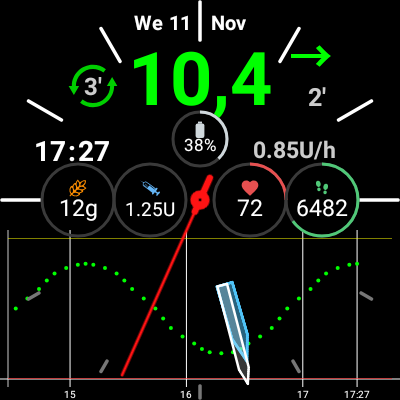

# AndroidAPS – personal changes

This is a personal fork of [nightscout/AndroidAPS](https://github.com/nightscout/AndroidAPS).
It adds a few changes, mostly for the **Wear OS watch app**. They were made for a OnePlus Watch 2R
(Wear OS 5, round 466 x 466 screen), but should work on other round Wear OS watches. On the phone,
the status lights count down to the end of the sensor and pod, and logs can be saved without email.

> **Not an official AAPS release.** These changes are not reviewed by the AAPS team and are not
> meant for upstream. AAPS controls insulin: build and use this only if you understand the code
> and the risk. The phone side changes only how often data is sent to the watch, the status
> lights, and how logs are saved. Nothing changes how insulin is given.

The full upstream README is in [`/README.md`](../README.md).

## Base and branches

All changes are made on top of upstream **4.0.0** (`master` at `f77abd9b82`).

| Branch | What it holds |
|---|---|
| `local/personal` | **The branch to build.** All changes below, merged. |
| `local/wear-battery` | Less battery use on the watch, fewer messages from the phone |
| `local/wear-hr-steps-design` | Heart rate and steps on the watch face, design *AAPS HR Steps* |
| `local/wear-wake-animation` | Wake-up animation, design *AAPS Tech*, and later design updates |
| `local/status-and-logs` | Phone: status lights count down to the real end, save logs to Downloads |

`master` of this fork is a plain copy of upstream `master`.

## What is different from upstream

### 1. Less battery use on the watch

- **Fewer redraws.** The Custom watch face draws once a minute when it shows no seconds,
  instead of every second. With seconds, everything that does not change every second is kept
  as a picture, and each second only the clock text and the second hand are drawn. The second
  hand is its own layer on top.
- **Less writing to storage.** Live data (BG, status, graph, treatments) is kept in its own small
  file. Before, every new BG value wrote the whole watch face design again, with all its images.
  Unchanged data is not written at all.
- **Less work per frame.** The design json is parsed only when it changes. Idle loops that woke up
  every 200 ms or 5 s now sleep or end.
- **Fewer messages from the phone.** After a new BG value the first update goes out at once; the
  other updates of that cycle wait for 30 s of quiet and are sent together. Changes made by the
  user (temp target, running mode, eat reminder) are still sent at once. Messages with data the
  watch already has are not sent again.

### 2. Heart rate and steps

- Two new complication sources: **AAPS heart rate** and **AAPS steps**. They use Wear OS Health
  Services *passive* monitoring: the watch measures these values anyway, and AAPS only receives
  them in batches. AAPS turns on no sensor of its own.
- Data is asked for only while such a complication is on a watch face. After a restart the watch
  registers again by itself.
- Without permission the complication says so, and a tap on it asks for the permission.
- On the Custom watch face, slots 1 to 4 start as heart rate, steps, COB and IOB.

### 3. Wake-up animation

- A watch face design can have an optional `animation` block: **falling rain** and an image that
  **beats at the measured heart rate**.
- It plays (24 frames per second) when you raise your wrist, when the watch face starts or becomes
  visible, or when you tap the screen. Then the face is still again.
- How long it plays is a setting of the Custom watch face on the watch, *Wake-up animation*: as the
  design asks (the default), off, or 3 to 30 seconds. AAPS Tech asks for 15 seconds.
- It never plays in ambient (always-on) mode, in simple UI, or in previews.
- Designs without the `animation` block work exactly as before.

### 4. Two watch face designs

The designs are in [`wear/cwf-designs`](../wear/cwf-designs). Install a zip the same way as any
other custom watch face for AAPS.

| AAPS Tech | AAPS HR Steps |
|---|---|
|  |  |
| Dark "cyberpunk" design: big digital time and BG in range colours, a table with IOB, carbs, basal, reservoir, heart rate and steps, the watch battery, and the graph. Rain and a beating drop in the logo when the watch wakes up. | The default analog design with round dials for COB, IOB, heart rate and steps, the watch battery, the date and a digital clock. |

The pictures are previews with sample values. The font of AAPS Tech is
[Rajdhani](https://fonts.google.com/specimen/Rajdhani) Bold (SIL Open Font License, see
`wear/cwf-designs/fonts`).

**Settings for AAPS Tech:**

- The design turns off *detailed IOB* itself. This only works if watch faces may change watch
  settings. If the first row of the table shows two numbers, turn off *Show detailed IOB* in the
  AAPS settings on the watch.
- Choose *AAPS heart rate* for complication 1, *AAPS steps* for complication 2 and the watch
  battery for complication 5.

### 5. Status lights count down (phone)

The status lights in Overview and Actions show the **time left** until a part stops, not its age.

- For known devices the countdown goes to the real end, grace period included. You do not have
  to set anything:

  | Device | Works | Grace | Ends after |
  |---|---|---|---|
  | Dexcom G7 | 10 days | 12 h | 10 days 12 h |
  | Dexcom G6 | 10 days | – | 10 days |
  | Omnipod Eros / DASH | 72 h | 8 h | 80 h |

  The sensor model comes from the newest BG reading, the pod from the active pump. On a pod the
  insulin row ends with the pod.
- **Yellow** when less than one day is left, **red** in the grace period.
- Under 10 hours the minutes show and the days go: `9h05m`, `45m`. After the end: `-2h10m`.
- Other devices and the pump battery count down to your *critical* threshold, with your warning
  and critical colors, as before.
- A 15 day G7 sends the same label as the 10 day one, so it would count down 5 days too early.
- AAPS only knows a new sensor when the BG source sends its start time. xDrip+ sends it for a G7
  only when it knows the sensor firmware, so keep xDrip+ up to date.

### 6. Save logs to Downloads (phone)

*Maintenance* has a new item **Save logs to Downloads**. It writes the same zip as *Send logs*
to the `Download` folder of the phone, with no email. No storage permission is needed.

## Install

1. Build `local/personal`: the watch app is `:wear:assembleFullRelease`, the phone app
   `:app:assembleFullRelease`.
2. Sign both with **the same key as the AAPS you have installed now**, and install with
   `adb install -r`. Then your data and settings stay.
3. Install a design zip from `wear/cwf-designs`.

## Tests

All changes have JVM / Robolectric tests in the `wear`, `plugins/sync` and `ui` modules. The designs are
built by tests (`CwfTechDesignTest`, `CwfHrStepsDesignTest`) that render the real watch face. These
tests check, for example, that no text is cut off, that all values in the table line up, and that
the rain does not make the table hard to read.

## Updating to a new upstream version

The version check of AAPS is not changed, so the app still tells you when a new AAPS version is
out. The changes are kept small so they can be moved to a new version: mostly new files, small
hooks in existing files, and their own strings file.

When a new version is out:

1. Bring `master` of this fork up to date with upstream (the *Sync fork* button on GitHub, or
   `gh repo sync aseesing/AndroidAPS -b master`), and fetch it.
2. Move `local/personal` with all its merges in one step:
   `git rebase --rebase-merges --onto <new master> f77abd9b82 local/personal`.
   Solve conflicts where git stops, then `git rebase --continue`.
3. Point the `local/wear-*` branches at their moved commits (`git branch -f <branch> <commit>`).
   `local/wear-battery` and `local/wear-hr-steps-design` each start from upstream on their own;
   `local/wear-wake-animation` starts from the merge of those two. `local/status-and-logs`
   starts from upstream on its own.
4. Run the `wear`, `plugins/sync` and `ui` tests, build, and push the branches with
   `git push --force-with-lease`. A rebase rewrites the commits, so a normal push is refused.
5. Change the base commit at the top of this file.
