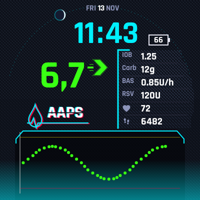
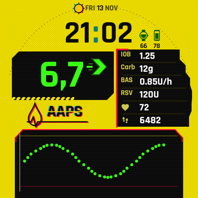
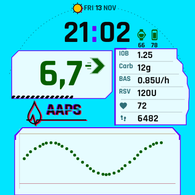
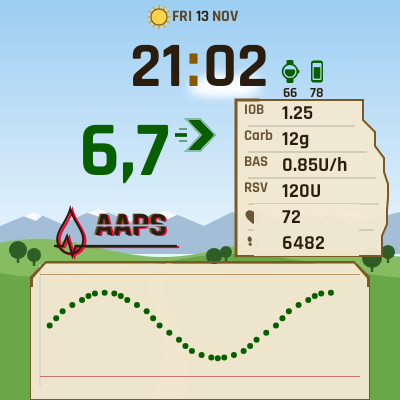

# AndroidAPS – personal changes

This is a personal fork of [nightscout/AndroidAPS](https://github.com/nightscout/AndroidAPS).
It adds a few changes, mostly for the **Wear OS watch app**. They were made for a OnePlus Watch 2R
(Wear OS 5, round 466 x 466 screen), but should work on other round Wear OS watches. On the phone,
the status lights count down to the end of the sensor and pod, and logs can be saved without email.
It also has the **Dexcom ONE+ / G7 driver** of an open upstream pull request, so AAPS reads the
sensor itself, and it **speaks the glucose value in the car**, so xDrip+ is not needed.

> **Not an official AAPS release.** These changes are not reviewed by the AAPS team and are not
> meant for upstream. AAPS controls insulin: build and use this only if you understand the code
> and the risk. Our own changes on the phone change only how often data is sent to the watch, the
> status lights, how logs are saved, they send a rough place to the watch and read the weather for
> that place from Open-Meteo (see 4), and they speak the glucose value in the car (see 10). **The
> Dexcom ONE+ / G7 driver (see 9) is not ours and is not yet reviewed upstream. It is the glucose
> source of the loop, and it can end a high temp basal when readings stop.**

The full upstream README is in [`/README.md`](../README.md).

## Base and branches

The changes 1 to 8 are made on top of upstream **4.0.0** (`master` at `f77abd9b82`). The Dexcom
ONE+ / G7 driver (see 9) is built on upstream `dev`, so merging it also brought the commits of
upstream `dev` that came after 4.0.0. Merged now: upstream **4.0.0** (`master` at `f77abd9b82`) and
pull request #5431 at `13005dae25` (2026-11-12), which holds upstream `dev` up to `951df2fa89`. So
the base of `local/personal` is upstream `dev`, not 4.0.0. Change 10 is made on top of that.

Upstream `dev` calls itself `4.0.1-dev-a`. AAPS sees the `-dev` and then turns the closed loop off
unless engineering mode is on. This fork sets the version to **`4.0.1`**, so the closed loop works
as before.

| Branch | What it holds |
|---|---|
| `local/personal` | **The branch to build.** All changes below, merged. |
| `local/wear-battery` | Less battery use on the watch, fewer messages from the phone |
| `local/wear-hr-steps-design` | Heart rate and steps on the watch face, design *AAPS HR Steps* |
| `local/wear-wake-animation` | Wake-up animation, design *AAPS Tech* (now *Cyberpunk*), and later design updates |
| `local/wear-day-night` | Day and weather looks, sun and moon on the edge |
| `local/wear-day-night-faces` | A day face and a night face, chosen in AAPS; the four Cyberpunk and Wilds designs |
| `local/status-and-logs` | Phone: status lights count down to the real end, save logs to Downloads |
| `local/wear-fast-wake` | Fast first frame after a wake, and the header that marks our own files |

`master` of this fork is a plain copy of upstream `master`.

## What is different from upstream

### 1. Less battery use on the watch

- **Fewer redraws.** The Custom watch face draws once a minute when it shows no seconds,
  instead of every second. With seconds, everything that does not change every second is kept
  as a picture, and each second only the clock text and the second hand are drawn. The second
  hand is its own layer on top.
- **Less writing to storage.** Live data (BG, status, graph, treatments) is kept in its own small
  file. Before, every new BG value wrote the whole watch face design again, with all its images.
  Unchanged data is not written at all.
- **Less work per frame.** The design json is parsed only when it changes. Idle loops that woke up
  every 200 ms or 5 s now sleep or end.
- **Fewer messages from the phone.** After a new BG value the first update goes out at once; the
  other updates of that cycle wait for 30 s of quiet and are sent together. Changes made by the
  user (temp target, running mode, eat reminder) are still sent at once. Messages with data the
  watch already has are not sent again.

### 2. Heart rate and steps

- Two new complication sources: **AAPS heart rate** and **AAPS steps**. They use Wear OS Health
  Services *passive* monitoring: the watch measures these values anyway, and AAPS only receives
  them in batches. AAPS turns on no sensor of its own.
- Data is asked for only while such a complication is on a watch face. After a restart the watch
  registers again by itself.
- Without permission the complication says so, and a tap on it asks for the permission.
- On the Custom watch face, slots 1 to 4 start as heart rate, steps, COB and IOB.

### 3. Wake-up animation

- A watch face design can have an optional `animation` block: **falling rain** or short
  **glitch bands**, and an image that **beats at the measured heart rate**.
- It plays (24 frames per second) when you raise your wrist, when the watch face starts or becomes
  visible, or when you tap the screen. Then the face is still again.
- How long it plays is a setting of the Custom watch face on the watch, *Wake-up animation*: as the
  design asks (the default), off, or 3 to 30 seconds. Cyberpunk asks for 15 seconds.
- It never plays in ambient (always-on) mode, in simple UI, or in previews.
- Designs without the `animation` block work exactly as before.

### 4. A day face and a night face, weather, sun and moon

- **Two faces:** in AAPS on the phone (Wear screen) you choose a **day face** and, if you want, a
  **night face**: two separate Custom watch face zips. The watch keeps both and shows the day face
  from sunrise to sunset and the night face at night. Without a night face, the one face shows day
  and night, as before. *Remove night face* goes back to one face.
- **When it is day** is the setting *Day / night look*: *Automatic* (the default, from sunrise to
  sunset), *Day face* or *Night face*. The always-on screen has its own setting, *Always-on look*:
  *Night face* (the default, a light screen there costs battery), *Day face*, or *Same as active
  screen*. Both settings are in AAPS on the phone (Wear plugin, Custom Watchface Settings) and in
  the settings of the Custom watch face on the watch. A change on the phone is sent to the watch; a
  change on the watch stays until the phone setting changes again.
- The watch works out sunrise and sunset itself. For that, the phone sends its last known place,
  **rounded to 0.1 degree (about 10 km)**, and only when AAPS has location permission. The phone
  starts no location request for it. Without a place the day is 07:00 to 19:00.
- **Weather:** the phone reads the weather at its rough place from Open-Meteo (free, no account)
  every half hour, and sends only the kind to the watch: clear, partly cloudy, cloudy or rain. A
  design can have a look for each under `weatherLooks` (`partly`, `cloudy`, `rain`); a look can
  swap pictures: `"images": {"Background": "BackgroundRain"}`. Weather older than 3 hours is not used.
- **Sun and moon on the edge:** a view can move along an arc with the new `orbit` key. The sun goes
  from sunrise (left) to sunset (right) with the value `sun_progress`, the moon through the night
  with `night_progress`. The moon follows the night, not the real moonrise.
- A design can show the **phase of the moon**: the new value `moon_phase` picks a picture. The
  watch works it out from the date, without phone or internet. (A dynData with pictures needs an
  `invalidImage`, or the watch uses one step less than there are pictures.)
- A design can still have a `dayLook` block, laid over it in the day; the four designs below do
  not use it any more.

### 5. Watch face designs

The designs are in [`wear/cwf-designs`](../wear/cwf-designs). Load a zip in AAPS as the day face or
the night face. A zip must stay under about 320 KB: the phone sends it to the watch in one message,
and a larger one does not arrive (with no error).

| Cyberpunk Tech | Cyberpunk Yellow | Cyberpunk Weather | Wilds Weather |
|---|---|---|---|
|  |  |  |  |
| `Cyberpunk_Tech.zip`, for the night. Dark neon design: big digital time and BG in range colours, a table with IOB, carbs, basal, reservoir, heart rate and steps, the watch battery and the graph. The moon goes along the edge through the night, with a cloud before it when it is cloudy. Rain and a beating drop in the logo when the watch wakes up. | `Cyberpunk_Yellow.zip`, for the day. Signal yellow with black panels; the glucose value keeps its neon colours on black. The sun along the edge, glitch bands and the beating drop when the watch wakes up. | `Cyberpunk_Weather.zip`, for the day. A colour per weather (cyan, lilac, grey) with light panels, clouds, and the sun along the edge. The glucose colours are dark there, with the same meaning. Glitch bands, and rain when it rains. | `Wilds_Weather.zip`, for the day. A painted landscape per weather (our own drawing), with parchment behind the table and the graph, and a warm sun. The landscapes (`Background.jpg` for sunny, `DayBackgroundPartly.jpg`, `...Cloudy`, `...Rain`) can be replaced by your own: 400 x 400, at most about 25 KB each, with a light sky where the time and the glucose value are. |

`AAPS_HR_Steps.zip` (the default analog design with round dials for COB, IOB, heart rate and steps)
is still there. In the four Cyberpunk and Wilds designs the age of the glucose value shows only
when it is 5 minutes or older, and a loop warning only when the loop has not run for 15 minutes;
both in red, under the arrow.

The pictures are previews with sample values. The font is
[Rajdhani](https://fonts.google.com/specimen/Rajdhani) Bold, cut to the Latin letters (SIL Open
Font License, see `wear/cwf-designs/fonts`).

**Settings for these designs:**

- The design turns off *detailed IOB* itself. This only works if watch faces may change watch
  settings. If the first row of the table shows two numbers, turn off *Show detailed IOB* in the
  AAPS settings on the watch.
- Choose *AAPS heart rate* for complication 1, *AAPS steps* for complication 2 and the watch
  battery for complication 5.

### 6. Status lights count down (phone)

The status lights in Overview and Actions show the **time left** until a part stops, not its age.

- For known devices the countdown goes to the real end, grace period included. You do not have
  to set anything:

  | Device | Works | Grace | Ends after |
  |---|---|---|---|
  | Dexcom G7 | 10 days | 12 h | 10 days 12 h |
  | Dexcom G6 | 10 days | – | 10 days |
  | Omnipod Eros / DASH | 72 h | 8 h | 80 h |

  The sensor model comes from the newest BG reading, the pod from the active pump. On a pod the
  insulin row ends with the pod.
- **Yellow** when less than one day is left, **red** in the grace period.
- Under 10 hours the minutes show and the days go: `9h05m`, `45m`. After the end: `-2h10m`.
- Other devices and the pump battery count down to your *critical* threshold, with your warning
  and critical colors, as before.
- A 15 day G7 sends the same label as the 10 day one, so it would count down 5 days too early.
- AAPS only knows a new sensor when the BG source sends its start time. xDrip+ sends it for a G7
  only when it knows the sensor firmware, so keep xDrip+ up to date.

### 7. Save logs to Downloads (phone)

*Maintenance* has a new item **Save logs to Downloads**. It writes the same zip as *Send logs*
to the `Download` folder of the phone, with no email. No storage permission is needed.

### 8. Fast first frame after a wake (watch)

When you raise your wrist or press the button, the watch waits for the first frame of the watch
face. On the OnePlus Watch 2R in *Smart mode*, a late frame left the watch on its own low-power
face until the button was pressed twice. Now the first frame after a wake only updates the date
and time. Data, colours, design and chart are filled in right after it, and the wake-up animation
starts with the next frame.

### 9. Dexcom ONE+ / G7 without xDrip+ (phone and watch)

Merged from the open upstream pull request
[nightscout/AndroidAPS#5431](https://github.com/nightscout/AndroidAPS/pull/5431) by MTR93600 (head
`13005dae`, 2026-11-12). It is not our code; see the pull request for the details.

- A new BG source **Dexcom ONE+ / G7** talks to the sensor over Bluetooth itself, so xDrip+ or
  the Dexcom app is not needed.
- Start, warm-up (with pre-soak), calibration, sensor status and a driver log are in the plugin.
- CGM alarms for this source, also on the watch, and *direct to watch*: the watch can read the
  sensor itself when the phone is away.
- **The CGM alarm settings** have their own card in the settings, *CGM alarms*, with one section
  per alarm (switch, level, delay, repeat, sound). The glucose alarms (urgent low, low, high, fast
  fall and rise) are **off** by default: turn on the ones you need.
- **It changes insulin delivery:** while no reading arrives in closed loop, it ends a temp basal
  that is above the profile basal. It never raises delivery.

Our changes to it (marked `PERSONAL PATCH`):

- The watch keeps our batched writes of live data (see 1) when it stores a reading it took from
  the sensor itself.
- **A fault in the driver can not end the app.** An exception in its background jobs, its BLE
  thread, its Bluetooth callbacks, the CGM alarms, the start screen buttons or direct-to-watch is
  logged, and the app (and so the loop) goes on. A failed Bluetooth step fails the connection, so
  the driver tries again. Each step of the plugin start is guarded on its own. A review found no
  place where the driver blocks the main thread, the loop or the pump command queue.

### 10. Speak glucose in the car (phone)

The *vehicle mode* speech of xDrip+, so that xDrip+ is not needed for it. It is the plugin **Speak
glucose in the car** under *General* in the Config Builder. The code is a port of xDrip+
`BgToSpeech`, `SpeechUtil`, `HeadsetStateReceiver` and `ActivityRecognizedService` (GPLv3, by
jamorham and others), changed where written below.

- **In the car** (as in xDrip+, both can be on):
  - *Detect the car by Bluetooth* (on by default): connect the phone to the car, open
    *Car and test* in the settings of the plugin, and choose the device that connected last as the
    car. While that device is connected, you are in the car. xDrip+ looks only at the hands-free
    connection; here the media connection (A2DP) counts too.
  - *Detect driving by movement* (off by default): Google activity recognition says when you are
    in a vehicle. It needs the *physical activity* permission. xDrip+ asks every few minutes; this
    uses the newer API that reports only the start and the end of driving.
- **What it says:** the glucose value and the trend, for example *"7.2, rising"*, in your unit and
  in the language of the phone (English when that language has no voice).
- **When it says it:**
  - the first reading in the car,
  - below the low mark or above the high mark (the marks of the overview): at once, and again
    every *Repeat a low or a high every* (default 10 min),
  - inside the range only when the value moved *Speak on a change of* (default 10 mg/dl) since the
    last time, or when it just came back from a low or a high,
  - never a reading older than 4 minutes, and never during a phone call.
- **How:** as navigation guidance with the music turned down for a moment, so Android Auto plays
  it on the car speakers like a navigation voice. xDrip+ instead waits up to 40 s for the music to
  stop.
- *Car and test* also shows whether you are in the car now, and has a button to say the newest
  value at once.

The rule for *when* is plain Kotlin in `commonMain` with its own tests (`CarSpeechRuleTest`).

## Install

1. Build `local/personal`: the watch app is `:wear:assembleFullRelease`, the phone app
   `:app:assembleFullRelease`.
2. Sign both with **the same key as the AAPS you have installed now**, and install with
   `adb install -r`. Then your data and settings stay.
3. Load a design zip from `wear/cwf-designs` in AAPS as the day face, and if you want another as the night face (for example `Cyberpunk_Weather.zip` by day and `Cyberpunk_Tech.zip` by night).

## Tests

All changes have JVM / Robolectric tests in the `wear`, `plugins/sync` and `ui` modules. The designs are
built by tests (`CwfTechDesignTest`, `CwfHrStepsDesignTest`) that render the real watch face. These
tests check, for example, that no text is cut off, that all values in the table line up, and that
the rain does not make the table hard to read.

## Updating to a new upstream version

The version check of AAPS is not changed, so the app still tells you when a new AAPS version is
out. The changes are kept small so they can be moved to a new version: mostly new files, small
hooks in existing files, and their own strings file. Our own files start with a
`PERSONAL PATCH` header; newer hooks in upstream files are marked with a `// PERSONAL PATCH`
comment.

Since the Dexcom ONE+ / G7 driver (see 9), `local/personal` holds a merge of upstream `dev`.
A rebase onto a new `master` would have to move all those `dev` commits too, so **merge** instead:

1. Fetch upstream: `git fetch https://github.com/nightscout/AndroidAPS dev:refs/remotes/upstream/dev`
   (or the new release tag).
2. Merge it into `local/personal`: `git merge upstream/dev`. Solve conflicts where git stops.
   When pull request #5431 is merged upstream, its commits come in this way and nothing else is
   needed for it.
3. Run the `wear`, `plugins/sync`, `plugins/source` and `ui` tests, build, and push with a normal
   `git push` (a merge does not rewrite commits).
4. Change the base commit at the top of this file.

Before the driver, the branches were moved with
`git rebase --rebase-merges --onto <new master> f77abd9b82 local/personal`, and the `local/wear-*`
branches were pointed at their moved commits.
